# node-red-contrib-python-venv

Node to use Python virtual environment in Node-RED

[](https://github.com/sponsors/404background)
[](https://www.npmjs.com/package/@background404/node-red-contrib-python-venv)
[](https://www.npmjs.com/package/@background404/node-red-contrib-python-venv)
[](https://github.com/404background/node-red-contrib-python-venv/discussions)

If you would like to find a sample flow or have questions, please visit [GitHub Discussions](https://github.com/404background/node-red-contrib-python-venv/discussions) page!

## Overview

With this node, you can run Python in Python's virtual environments in Node-RED.

When you install this node, python virtual environment (pyenv folder) is also created.  
You can run python(.exe) or pip(.exe) in that environment.

## Requirements

Python 3 with the `venv` and `pip` modules must be available on the system.

- **Debian/Ubuntu:** `sudo apt install python3-venv python3-pip`
- **Windows:** install Python from [python.org](https://www.python.org/) (the Microsoft Store version may not include `venv`)

If Python cannot be found while the node is being installed, the installation still succeeds and the virtual environment is created the first time you deploy a venv configuration node. The configuration dialog shows a warning when something is missing.

Sample flows are in the examples folder.  
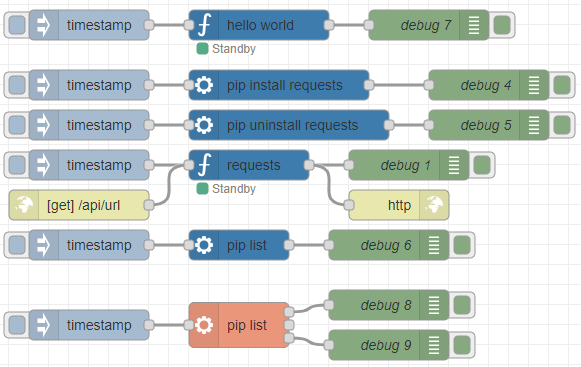

## Nodes

### venv node

python(.exe) is in the ./pyenv/Scripts/python.exe or Python virtual environment you have added.

Write your Python code in the node.  
The program is saved in the virtual environment and executed.

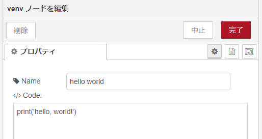

You can access Node-RED messages like `print(msg['payload'])`.

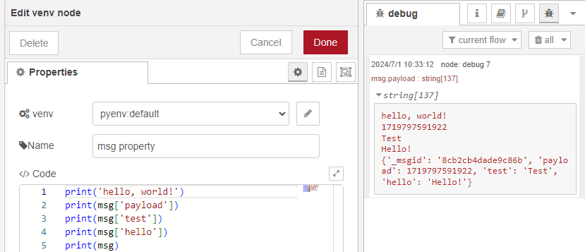

You can also set values on the `msg` object directly from Python:  
`msg['payload'] = 'hello'`, `msg['topic'] = 'my-topic'`.  
These values will be passed to downstream nodes without using `print()`.  
If `print()` output is present, it will override `msg['payload']`.

You can also access flow and global objects like `print(node['flow']['payload'])`, `print(node['global']['payload'])`.  
Values assigned to `node['flow']` and `node['global']` in Python are written back to the Node-RED context.

> **Note:** `node['flow']` and `node['global']` are snapshots taken at the start of execution. Changes made by other nodes during execution are not visible to Python, and Python's changes are only written back when the process exits. In Continuous mode, this means real-time sharing with other nodes is not possible. If you need to share values in real time, use `print()` and write to context via a downstream function/change node.

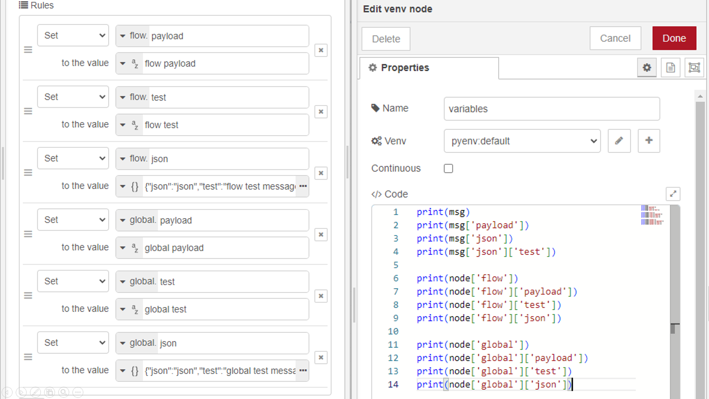

The number of running nodes is displayed in the status.

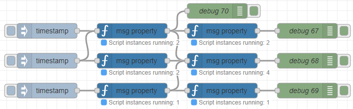

The venv node stops execution when `msg.kill` or `msg.terminate` is set to `true`, aligning its behavior with Node-RED's `exec` node.

#### Outputs

Like Node-RED's `exec` node, the venv node has three outputs:

| #   | Output      | `msg.payload`                                                                                                              |
| --- | ----------- | -------------------------------------------------------------------------------------------------------------------------- |
| 1   | stdout      | Standard output. Not sent when the script fails, so a message here still means success.                                    |
| 2   | stderr      | Standard error. Sent only when the script wrote to stderr, including on failure, so tracebacks can be handled in the flow. |
| 3   | return code | An object such as `{ code: 0 }`, with `signal` added when the process was killed. Sent every time the process exits.       |

In Continuous mode, stdout and stderr are streamed line by line to outputs 1 and 2, and output 3 fires when the process exits.

A failing script is still reported as a node error, so existing `catch` nodes keep working.

### pip node

pip(.exe) is in the ./pyenv/Scripts/pip.exe or Python virtual environment you have added.

You can run pip commands like install, uninstall, list.  
Select the commands.

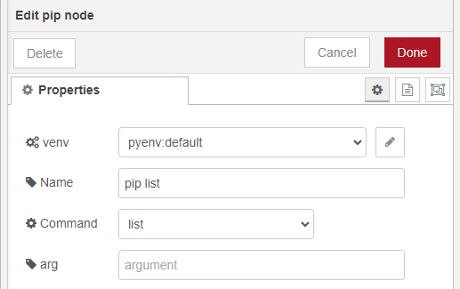

This node uses pip in the virtual environment, so it is different from the existing Python environment packages.  
Please compare.

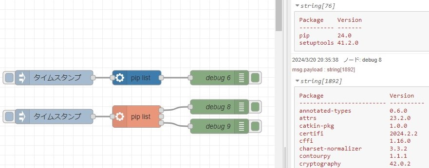

### venv-exec

This node can execute executable files in Scripts or bin folder.

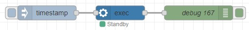

You can see the name of the executable in List Executables mode.  
Then you can execute it with arguments in Execute mode.

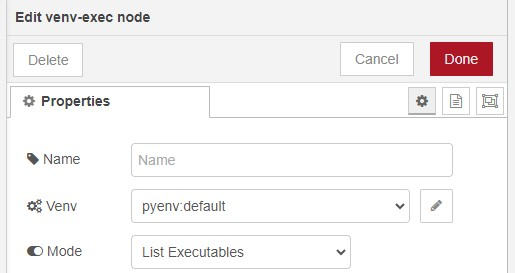
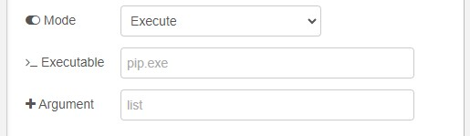

> **Note:** Arguments are split on whitespace and passed to the executable directly, without a shell. Wrap a value in single or double quotes to keep spaces inside it (for example `-c "print(1 + 1)"`). Shell features such as pipes and redirection are not available.

The venv-exec node stops execution when either `msg.kill` or `msg.terminate` is set to `true`, aligning its behavior with Node-RED's `exec` node.

#### Outputs

The venv-exec node has the same three outputs as the venv node: stdout, stderr and the return code.

### venv-config (config node)

You can create and switch between multiple Python virtual environments.  
You need to add and set the name of the virtual environment.  
If you add a node with the same venv Name, only one virtual environment will be created.

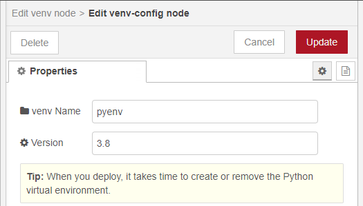

The nodes can be executed by creating virtual environments even if the venv Name contains spaces or is an absolute path.  
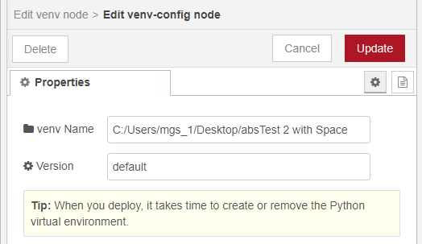

#### Python version

You can specify the Python version to create the environment with.

- **Windows:** the requested version is selected through the `py` launcher (`py -3.11`).
- **Linux/macOS:** the versioned interpreter is used (`python3.11`). If it is not installed, the default `python3` is used instead and a warning is shown.

Install the Python version you want to use in advance.

#### Using an existing virtual environment

If the venv Name points at a directory that is already a Python virtual environment (it contains `pyvenv.cfg`), that environment is adopted instead of a new one being created. Only a small `path.json` file is added to it, so environments created outside of Node-RED can be used as they are.

If the directory exists but is not a virtual environment, nothing is created and an error is reported.

#### Deleting a configuration node

When a configuration node is deleted, the virtual environment is removed **only if this node created it**. A marker file (`.node-red-venv-created`) written at creation time is what distinguishes the two, so an environment you adopted from outside is never deleted.

Even then, only the entries a virtual environment is made of are removed (`Scripts`/`bin`, `Lib`/`lib`, `Include`/`include`, `share`, `Temp`, `pyvenv.cfg`, `path.json`) together with the `.py` files the venv nodes generated. Any other file you put in the folder is left untouched, and the folder itself is only removed once it is empty.

The absolute path that will be affected is shown in the configuration dialog, and a warning notification is displayed when you delete the node.

## Development

```sh
npm install     # install dev dependencies
npm test        # run the unit tests
npm run lint    # run ESLint
npm run prettier:check
```

## Other Links

### Technical Articles

I refer to "Creating Nodes" page of Node-RED.  
<https://nodered.org/docs/creating-nodes/>

My article: Creating Nodes for Node-RED Part 1 (python-venv)  
<https://404background.com/en/programming/creating-nodes-1/>

My article: python-venv node development history (2024)  
<https://qiita.com/background/items/3244fc1b70cc454befef>

### Nodes created based on this node

voicevox-core node: Node that outputs Japanese audio files using voicevox-core  
<https://flows.nodered.org/node/@background404/node-red-contrib-voicevox-core>

whisper node: Node to transcribe text using Open AI's Whisper  
<https://flows.nodered.org/node/@background404/node-red-contrib-whisper>
